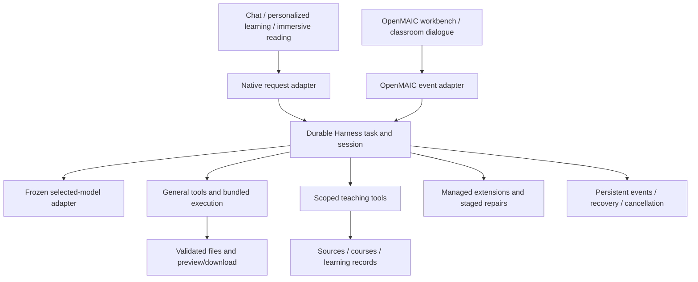

# Architecture: one Harness execution core

DeepSteam retains its learning and classroom interfaces while moving interactive model/tool turns to a common execution host.

## Code entry points

| Boundary | Source |
| --- | --- |
| Native turn and surface adaptation | [`integration/harness_turn.py`](../integration/harness_turn.py) |
| Durable task admission, ownership, polling, cancellation, errors | [`integration/harness_execution.py`](../integration/harness_execution.py) |
| Official Harness loop and tool registry | [`integration/harness/host.mjs`](../integration/harness/host.mjs), [`workspaces.mjs`](../integration/harness/workspaces.mjs) |
| Task lifecycle and structured errors | [`execution_tasks.mjs`](../integration/harness/execution_tasks.mjs), [`execution_errors.mjs`](../integration/harness/execution_errors.mjs) |
| Teaching-tool bridge | [`surface_tools.mjs`](../integration/harness/surface_tools.mjs) |
| OpenMAIC event facade | [`harness-agent.ts`](../upstream/OpenMAIC/lib/agent/runtime/harness-agent.ts) |
| Workbench and classroom orchestration | [`runner.ts`](../upstream/OpenMAIC/lib/server/agent-runtime/runner.ts), [`director-loop.ts`](../upstream/OpenMAIC/lib/chat/pi/director-loop.ts) |
| Authenticated internal APIs and file links | [`portal/app.py`](../portal/app.py) |
| Embedded classroom storage | [`deepsteam-local-pool.ts`](../upstream/OpenMAIC/lib/persistence/deepsteam-local-pool.ts) |
| Extension and repair lifecycle | [`extensions.mjs`](../integration/harness/extensions.mjs), [`repairs.mjs`](../integration/harness/repairs.mjs), [`repair_bundle.py`](../scripts/repair_bundle.py) |

OpenMAIC's Pi-compatible event facade does not start Pi's separate model loop for these turns. Existing course generation, editing, playback and domain services still run in their respective components. "One execution core" describes interactive agent dispatch; it does not mean every parser, speech call or background service has become a Harness agent.

## Shared contracts

Each admitted turn retains its native surface, conversation/turn identity, workspace owner, selected-model snapshot, configuration version and source references. Previous conversation messages are context; historical tool calls are not replayed as new actions. Reasoning parameters are mapped to the selected adapter's supported values rather than sent indiscriminately.

General file/search/execution/document tools are registered directly. Larger browser, subagent, scheduling, planning and MCP groups can load on demand. Registration and executable capability are recorded separately from tested behavior. The bundled Python and Node paths are supplied by the application, not inferred from the user's system PATH.

Progress includes streamed content, tool events, questions, cancellation and a terminal outcome. Failures retain a code, stage, message, diagnostic reference and retryability where available; execution errors also retain exit status and bounded output. A success-looking empty directory is not a deliverable.

## Sources, files and records

Transcript tools page through backend subtitle records and retain timestamps and source identity. Teaching context can include original book pages, figures, video transcripts and course/chat records. A rendered subtitle viewport or a whole-book page index does not establish complete source reading.

Generated files are checked for existence, nonempty bytes and supported-format parsing before presentation. Native interfaces use the immutable presentation service; OpenMAIC uses file-scoped signed download links. Original-source attachments remain labeled separately from generated documents.

Learning summaries, chat archives and mastery state are different records. A generated summary cannot replace raw conversation history or silently become evidence of mastery. Reconnect subscribes to the original admitted task; request keys and persisted state prevent blind replay of prior writes.

## Permissions and lifecycle

Execution respects the configured workspace/full-access policy. Application-owned credentials stay in the credential service. Extensions have source/version/dependency records and an uninstall path. Self-repair prepares a reversible staged patch and validates it before activation; isolated repair tests do not prove arbitrary autonomous production changes are safe.

The native result boundary is significant: Partner persistence consumes the public result dictionary and canonical RESULT event, not an internal `LoopOutcome` object. The r11 follow-up restores this contract and preserves failure/cancellation and event-source identity.

See [validation](validation.md) for actual test evidence and [source provenance](source-provenance.md) for build limitations.
